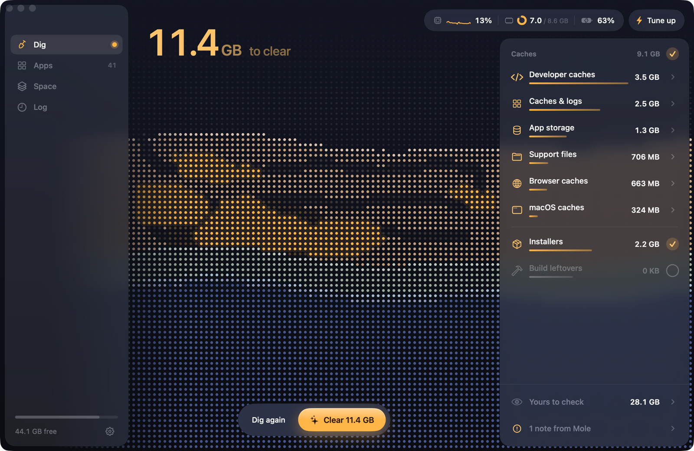

<h1>
  <picture>
    <source media="(prefers-color-scheme: dark)" srcset="docs/logo/burrow-dark.svg">
    
  </picture>
</h1>

Take back your Mac's disk. Burrow finds what's eating your space, clears it safely, and removes apps along with everything they leave behind. Native, open source, free.



- **Dig**: one scan for caches, old installers and build leftovers. Review, uncheck what you want to keep, clear.
- **Apps**: uninstall an app with its data, caches and settings. Strip Intel code from apps that still carry it.
- **Space**: see where your disk went, folder by folder.
- **Log**: every change Burrow made, down to the file.

Tune up runs routine maintenance, and CPU, memory and battery stay live in the toolbar.

## Install

macOS 14+:

```bash
curl -fsSL https://raw.githubusercontent.com/salman-frs/Burrow/main/install.sh | bash
```

Or download `Burrow.dmg` from [Releases](https://github.com/salman-frs/Burrow/releases/latest). It isn't notarized, so allow it once in System Settings > Privacy & Security > Open Anyway.

## Safe by default

- Every scan is a dry run. Nothing changes until you press Clear or Uninstall.
- Installers and apps go to the Trash. Build leftovers are offered only after 7 days untouched, and start unchecked.
- If what's about to be removed doesn't match exactly what you picked, Burrow backs out.
- Space only trashes items inside your home folder, never the ones macOS depends on.
- Your password is used for a single run and never stored. Touch ID works too.

## Built on Mole

Cleaning, uninstalling and disk analysis run on [Mole](https://github.com/tw93/Mole) by tw93. Burrow bundles a pinned version and tests against its real output, so a Mole update can't silently break the app.

## Build

Requires macOS 14+, Swift 6 (Command Line Tools are enough) and Go.

```bash
./scripts/build-app.sh
```

Writes `dist/Burrow.app`. Set `MOLE_SOURCE=/path/to/Mole` to build from a local checkout and `SIGN_IDENTITY` to sign for distribution. Without Xcode, the app builds for Apple Silicon only.

Debug build:

```bash
swift build
BURROW_MOLE=.build/app/mole/mole BURROW_SESSION_HELPER=.build/debug/burrow-session .build/debug/Burrow
```

## Test

```bash
./scripts/test.sh
```

With `MOLE_SOURCE` set, live tests also run against that checkout. They only use dry runs.

To update Mole, bump `MOLE_VERSION`, run the live tests against that tag, and refresh `Tests/BurrowCoreTests/Fixtures` from its output.

## Release

Bump `VERSION`, merge, then push a matching tag. CI builds and publishes the release.

```bash
git tag v0.1.0 && git push origin v0.1.0
```

## License

GPL-3.0, same as Mole. Not affiliated with Mole or Mole for Mac.
